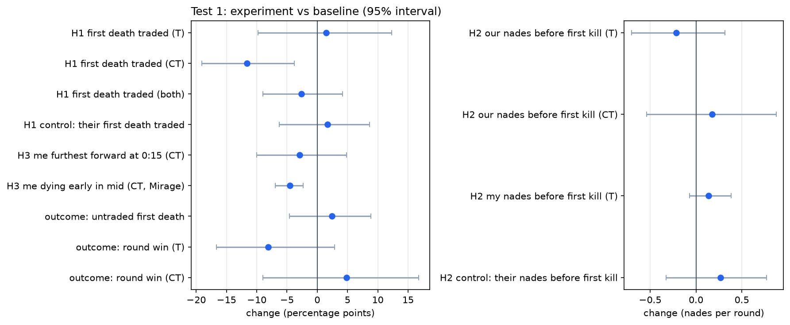
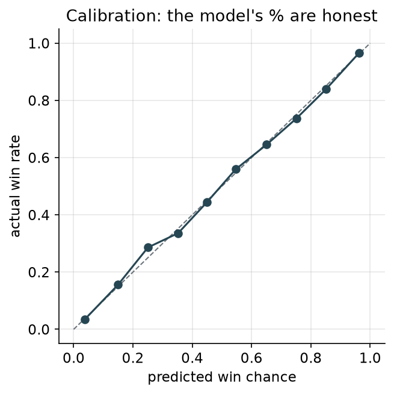
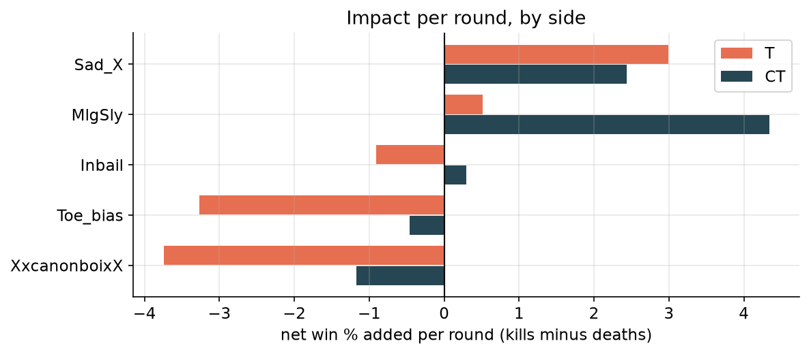

# CS2: A/B testing my own gameplay

I've played Counter-Strike since I was 15. This is a long-running project where I use my own FACEIT match data to find out why we lose rounds, then **change one thing about how I play, measure it from my demos, and keep or drop it based on what the data says.** Every test is written down before I play, and the result gets reported whatever it is, including "no clear difference".

**Status:** exploration done (5 notebooks). Test 1 stopped early (written up). Test 3 running.

## Test log

| # | Test | When | Status | Result |
|---|---|---|---|---|
| 1 | Team habits: trade the first fight, more nades, me playing back on CT | 9–17 Nov 2026 | Stopped at 12/20 matches | The team never adopted the habits, so nothing moved. Lesson: only test things I control myself. [Notebook](notebooks/experiments/01_team_habits.ipynb) · [plan + write-up](experiments/test1_team_habits.md) |
| 2 | MAC-10 vs AK, assigned by a random card | 17 Nov 2026 | Withdrawn before starting | The gun changes where I play, so it couldn't test the gun on its own. |
| 3 | Planned CT rushes: 2–3 per half off a good spawn, never the same spot twice | from 17 Nov 2026, ~20 matches | **Running** | [plan](experiments/test3_ct_rushes.md) |



## What the exploration found

From 138 FACEIT matches and 64 parsed demos (Sep–Nov 2026):

- **Losing the first fight untraded is the main way we lose rounds.** It happens in 37% of gun rounds and we win only ~25% of those. Winning the opening duel multiplies the odds of winning the round by ~6. ([02](notebooks/exploration/02_why_we_lose_rounds.ipynb))
- **A win-probability model for every moment of a round** (logistic regression on players alive, side, bomb and equipment; **AUC 0.87** on unseen matches, calibrated). It turns each kill and death into "win % added", so I can measure who actually helps us win rounds: me +4.3 per CT round (team best), +0.5 on T. ([04](notebooks/exploration/04_my_impact.ipynb))
- **Several "obvious" causes didn't hold up.** Being "disjointed", getting held at site entrances, utility damage, and clumping on T all turned out to be consequences of losing the opener, not causes, once compared within the same match. ([02](notebooks/exploration/02_why_we_lose_rounds.ipynb), [03](notebooks/exploration/03_enemy_utility.ipynb), [05](notebooks/exploration/05_good_vs_bad_t_sides.ipynb))
- **One lead survived:** 2+ mid smokes before the first kill on Mirage T goes with +10 pts on the opening duel. The cut-off was picked after seeing the data, so it needs a proper test. ([05](notebooks/exploration/05_good_vs_bad_t_sides.ipynb))

<p>
  
  
</p>

## How I run tests

1. **One change at a time**, and only things I control myself.
2. **Written down before playing**: what I do in game, what gets compared, for how long, and the success rule.
3. **Length depends on how often it happens**: a flash or a position needs ~1–2 weeks, something rare ~20 matches. Match wins would need ~100 matches, so they're never the main measure.
4. **Compare within the same matches when possible**, and check a control (what opponents did) so a change in lobbies isn't mistaken for a change in me.
5. **Uncertainty from a match-level bootstrap** (resampling whole matches, not rounds).

## Repo layout

```
notebooks/
  exploration/     01–05: why we lose rounds, enemy utility, my impact (win-probability model), T sides
  experiments/     one results notebook per finished test
experiments/       each test's plan (written before playing) and write-up
src/
  pipeline/        FACEIT API → demos → round, kill and position tables → features; shared WPA model
  experiments/     the scorer for each test, written before the test started
  analysis/        one-off checks (blowouts, solo play)
tools/             generators that build the notebooks
figures/           charts used in the notebooks and this README
dashboard/data/    tables exported for the dashboard
docs/              JOURNAL.md (dev log, dead ends included), PORTFOLIO.md
```

## Run it

```bash
python -m venv .venv
.venv\Scripts\activate          # Windows  (macOS/Linux: source .venv/bin/activate)
pip install -r requirements.txt
cp .env.example .env            # then paste your FACEIT API key into .env
python src/pipeline/fetch_faceit.py
python src/pipeline/build_dataset.py
```

Demos are downloaded by hand from FACEIT match rooms into `data/raw/demos/`, then `prepare_demos.py → parse_demos.py → features.py`. A free FACEIT API key comes from [developers.faceit.com](https://developers.faceit.com) (server-side key). Raw data isn't in the repo.

**Built with:** Python, pandas, scikit-learn, matplotlib, demoparser2 (demo parsing), the FACEIT Data API.
